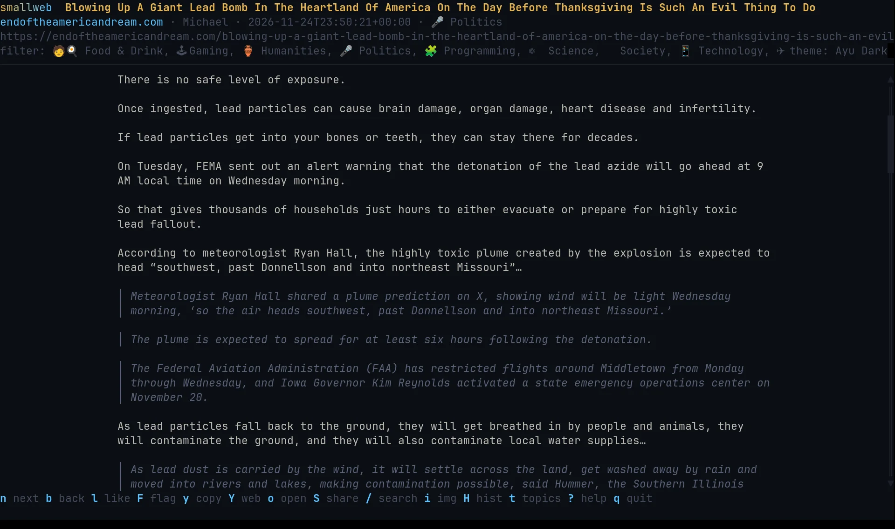
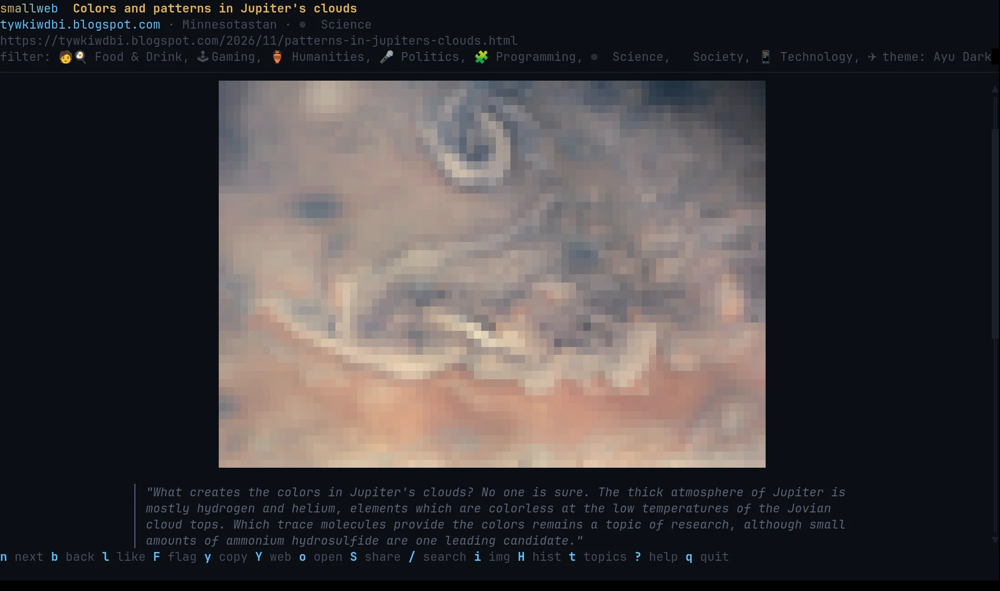
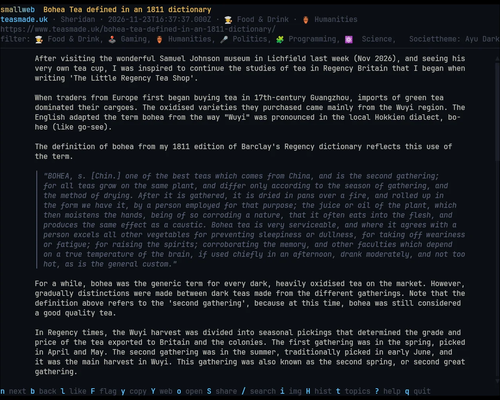

# smallweb

A terminal reader for [Kagi Small Web](https://kagi.com/smallweb). It pulls random posts from
Small Web's deck, extracts the article with [Readability](https://crates.io/crates/dom_smoothie),
and renders it as readable text in a [ratatui](https://ratatui.rs) interface themed by
[opaline](https://crates.io/crates/opaline).

## Screenshots

Article reading view with headings, lists, and block quotes.



Inline article image rendering.



Built-in key help overlay.



## Build

```sh
cargo build --release
./target/release/smallweb
```

or install it:

```sh
cargo install --path .
```

## Keys

| Key | Action |
| --- | --- |
| `n`, `→`, `]` | Next random post |
| `/` | Search the article text |
| `N` | Previous article search match (while searching) |
| `b`, `←` | Go back to the previous post |
| `l` | Toggle like on the current post (sent to Kagi) |
| `F` | Flag the current post as inappropriate (sent to Kagi) |
| `y` | Copy the original URL |
| `Y` | Copy the Small Web URL for the post |
| `o`, `Enter` | Open the original post in the configured browser |
| `S` | Run the configured share command with the post URL |
| `i` | Toggle inline images |
| `H` | Fuzzy-search the history of seen posts |
| `t` | Select topics to filter random posts |
| `T` | Theme picker with live preview; selection is saved |
| `j`/`k`, `↑`/`↓` | Scroll one line |
| `d`/`u` | Scroll half a page down / up |
| `Space` | Scroll to the beginning of the next paragraph or image |
| `PgDn` | Page down |
| `PgUp` | Page up |
| `g`, `G` | Top / bottom |
| `r` | Reload the article, or retry loading posts |
| `?` | Help |
| `q` | Quit (also `Ctrl+C`) |

In the topic picker: `Space` toggles, `a` selects all, `c` clears, `Enter` applies and saves the
selection to `config.toml`, and `Esc` cancels. Selected topics are ORed; an empty selection means
all topics.

`/` opens article search. Type a query and press `Enter`; `n` and `N` cycle forwards and backwards
through matches, and `Esc` clears the search. While a search is active, `→`/`]` still load the next
post.

Posts seen are remembered across sessions, so the random deck does not offer them again, and `b`
walks back through the posts you have viewed. `H` opens a fuzzy-searchable history: type to
filter and rank by title, domain, author, URL, or topic, and select with `↑`/`↓`. In the history
pane, `Enter` views the selected post inside the app, `Ctrl+O` opens it in the configured browser,
and `Ctrl+S` runs the configured share command.

Seen-post history and the back stack are persisted as state, not config, in
`$XDG_STATE_HOME/smallweb/history.json` (default `~/.local/state/smallweb/history.json`). Set
`SMALLWEB_HISTORY` to override the path. The file is written with user-only permissions on Unix
and keeps up to 200 seen posts and 100 back entries. The old `config.history.json` file is read
once for migration if no state history exists.

## Configuration

Config lives at `~/.config/smallweb/config.toml` (respects `XDG_CONFIG_HOME`), or at the path in
`SMALLWEB_CONFIG` / `--config`.

```toml
# Opaline theme id or a path to a theme TOML.
# Selecting a theme with `T` writes its id back here.
theme = "catppuccin-mocha"

# The URL is appended to this command. Use {} or %s as an explicit placeholder.
browser = "firefox --new-tab"

# Optional share command. Receives the post URL as its argument.
share = "toot post"

# Render article images inline. Default: false. Toggle at runtime with `i`.
images = false

# Initial topic filter. Applying a selection with `t` writes it back here.
# Empty or omitted means all topics.
topics = ["programming", "science"]
```

`browser` falls back to `$BROWSER`, then `xdg-open` (Linux), `open` (macOS), or
`cmd /C start ""` (Windows). `share` has no default; pressing `S` without it shows a warning.
Both commands receive the post URL as their final argument, unless they contain `{}` or `%s`.
The theme picker (`T`) applies the selected theme and saves it to `theme` in the config.

Run `smallweb --list-themes` to list the built-in opaline theme ids.

## Notes

- This uses Kagi's public Small Web deck, like/unlike, and flag endpoints, which are not a
  documented public API. Likes are real reactions sent to Kagi; pressing `l` again removes the
  reaction. Flags are real reports sent to Kagi.
- Article extraction uses `dom_smoothie`, a Rust port of Mozilla Readability. Pages whose content
  is mostly JavaScript may produce little readable text; press `o` to read those in the browser.
- Article images are off by default. Set `images = true` in the config or press `i` to enable them.
  Enabled images are fetched in the background and rendered inline through `ratatui-image`, using
  the Kitty, Sixel, or iTerm2 protocol when available and truecolor half blocks otherwise. Up to 12
  images per article are loaded. Failed, oversized, or unsupported images (including SVG) fall back
  to their alt text. Disabling images shows compact alt-text placeholders; an in-progress image
  batch may finish in the background.
- Only the Small Web blogs deck is used. Videos, code, comics, search, and river views are not
  implemented.
